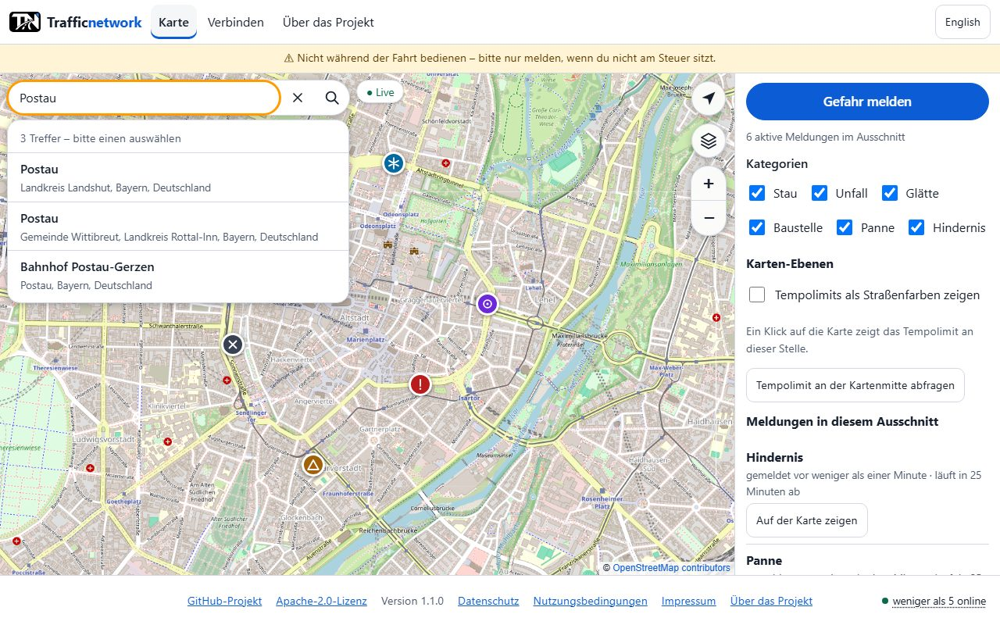

# Place search on the map (server 1.2.0)

The map page has a search bar like a navigation app's: type a place or an address, press Enter (or the magnifier), pick a hit - the
map moves there and marks it with a pin. Nothing else about the page changes: tapping the map still shows the speed limit.



## Who talks to whom

```
browser  --GET /v1/places/search?q=Postau&lat=48.6&lng=12.2&lang=de-->  this node  --GET …/search?q=Postau&format=jsonv2&viewbox=…-->  place service
```

* **The node asks the service, never the browser.** The page's Content-Security-Policy is unchanged (`connect-src` stays the node
  itself), and the service never sees a visitor's address - only the node's, with a User-Agent that names the project
  (`trafficnetwork-node (+<PROJECT_REPO_URL>)`).
* What the service learns: the **search term** (which can be an address - the privacy notice says so) and a **soft area**: the
  map centre rounded to 0.1° (about 10 km), turned into a preferred box of about one degree. Results inside it rank first; it is
  never a limit (`bounded` stays off), so searching for a far-away place works.
* **The node keeps nothing on disk.** Term and answer live in memory for `PLACE_SEARCH_CACHE_SECONDS` (default 1 h) so that the
  same search is one request; not in the database, not in the access log (`LOG_PRIVACY_MODE` already removes query strings), and the
  response says `Cache-Control: no-store` so no proxy keeps it either.
* **Usage policy of the public instance** (https://operations.osmfoundation.org/policies/nominatim/) is kept in one place: one request
  at a time and at least `PLACE_SEARCH_MIN_INTERVAL_MS` (1100 ms) apart, an identifying User-Agent, cached answers, and **no
  search-as-you-type** - the page searches when the visitor asks it to. A busy node should run its own Nominatim (or a compatible
  service) and set `PLACE_SEARCH_URL`.

## API

```
GET /v1/places/search?q=<2..120 characters>[&lat=&lng=][&lang=de|en]
  -> 200 { "places": [ { "id": "r4711", "name": "Postau", "label": "Postau, Landkreis Landshut, Bayern, Deutschland",
                          "lat": 48.5961, "lng": 12.1923, "kind": "administrative" | null,
                          "bbox": [west, south, east, north] | null } ] }          // at most 6, in the service's order
  -> 400 q too short/long, or lat/lng not a position
  -> 502 PLACE_SEARCH_UNAVAILABLE   the service is down, too slow or answered with an error (nothing is remembered about it)
  -> 429 (web sessions: counts against the heavy-read limit WEB_HEAVY_READ_LIMIT_PER_IP_PER_MINUTE)
```

Any authenticated client may use it, not only the page. The endpoint exists only when `PLACE_SEARCH_URL` is not `none`;
`GET /v1/config` → `placeSearch.enabled` says so, and `/web-config.json` → `placeSearchHost` (null = no search bar) names the
service for the privacy notice.

## Configuration

| Variable | Default | |
|---|---|---|
| `PLACE_SEARCH_URL` | `https://nominatim.openstreetmap.org/search` | a Nominatim-compatible `…/search` endpoint; empty = that default; `none` = no place search (no bar, no endpoint) |
| `PLACE_SEARCH_TIMEOUT_MS` | 8000 | |
| `PLACE_SEARCH_MIN_INTERVAL_MS` | 1100 | least time between two requests to the service |
| `PLACE_SEARCH_CACHE_SECONDS` | 3600 | how long an answer is kept in memory (0 = not at all) |

## The page

* The bar sits at the top left of the map (phone and desktop), 44 px high; the hits open under it as a list of buttons: name in bold,
  the rest of the line (county, state, country) below.
* Keyboard: Enter searches; ↓ moves into the list, ↑/↓ walk it, Enter chooses, Esc closes the list (and goes back to the box
  from inside it). A tap or click outside closes it.
* Choosing a hit fits the map to its bounding box (never closer than zoom 17; a single point is shown at zoom 16 or closer), puts a
  pin with the name on it and announces "Die Karte zeigt: …" to screen readers. The × empties the box and removes the pin.
* Messages in words: too short, searching, "n Treffer", nothing found, service not reachable, too many searches.
* German and English; the page asks the node for the language it shows.

## Limits and honest caveats

* The quality of the hits is the service's: house numbers and small places depend on OpenStreetMap's data.
* A search needs the network and the service; where the node cannot reach it the visitor gets "nicht erreichbar" and the rest of the
  page is unaffected.
* Not federated, not part of the client library (yet): it is a feature of the web page and a plain read endpoint.

## Tests

| Rule | Where |
|---|---|
| Reading the answer (box order, bad rows, limit, naming), the polite client (user agent, soft area only, one request for the same search, pace, failures) | `tests/unit/place-search.test.ts` |
| The endpoint for web sessions against a local geocoder: results, one request for repeated searches, empty answer, refusals, 502, heavy limit, config, switch off | `tests/integration/places.test.ts` |
| The page: search, keyboard, messages, clear, language, tap on the map, no bar without a service, axe light/dark, phone layout | `e2e/place-search.spec.ts` |
